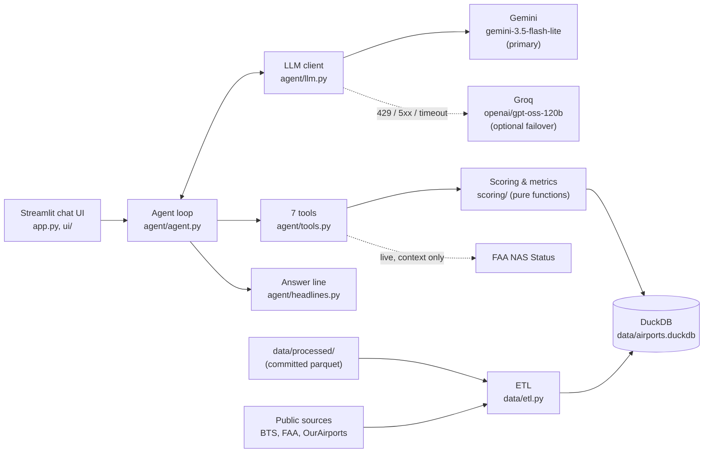

# Design: Airport Investment Intelligence Agent

## 1. Overview

**Problem.** Investment analysts need to find US airports where terminal or capacity investment is most likely
to pay off, which means comparing passenger demand with the capacity available to serve it.

**What the agent does.** A chat assistant (text or voice) answers questions such as "Which airports in New
England are strong candidates for terminal expansion?" or "What is the unmet flight demand at SFO and why?".
A language model interprets the question and chooses a tool. The tools compute every number with
deterministic Python on public aviation data. Each answer shows the result, a short explanation, the
assumptions, the data period and the full evidence tables.

**Scope.** US commercial airports and passenger service only (all-cargo flights excluded). The standard window
is the trailing 12 months **Sep 2025 – Aug 2026**; growth compares it with **Sep 2024 – Aug 2025**. The agent
refuses, with a short reason and an in-scope alternative: non-US airports, construction costs, financing and
returns, fares, airline strategy, and forecasts.

## 2. Architecture

Every tool returns the envelope `{data, sources, data_period, assumptions, caveats}` (shown in *Evidence*) plus a
compact, human-readable view for the LLM. Scoring functions are pure and unit-tested; every constant is in
`scoring/config.py`. If the DuckDB file is missing, the app builds it on first start from the committed
`data/processed/` parquet files, with no network needed.

## 3. Data sources

| Source | Access | Period | Feeds |
|---|---|---|---|
| BTS T-100 Segment, all carriers | Manual download (TranStats web form) | Jan 2024 – Aug 2026 | Passengers, seats, departures, load factor (average, peak month), growth, completion gap, long-haul share |
| BTS Airline On-Time Delay Cause | Public file download (TranStats delay-cause page, scripted) | Sep 2024 – Aug 2026 | Delay rate, NAS delay share, cancellation rate |
| BTS T-100 Segment Summary by Origin Airport (Socrata `r495-tyji`) | Public API (Socrata SODA) | Jan 2024 – Jul 2026 | Operations per runway (all-carrier departures), passenger cross-check |
| FAA Passenger Boarding (Enplanement) data | Public file download (.xlsx) | CY2023 – CY2025 | Hub size (ranking universe, peer groups), calendar-year growth cross-check |
| OurAirports | Public file download (CSV) | Current snapshot | Airport names and states, commercial runway count |
| FAA NAS Status | Public API (live, not formally documented) | Real time | Live delays and ground stops: context only, never scored |

Provenance, exact URLs and the manual T-100 download steps are in `data/raw/README.md`; the source checks and
KPI feasibility are in `docs/data_validation.md`. The processed files and their row counts are listed in
`data/processed/README.md`.

**Data validation** (`data/quality.py`, run at the end of every ETL):
- **Passenger cross-check:** CY2025 passengers from T-100, Socrata and FAA enplanements agree within 1% for the
  reference airports BOS, LAX, SNA, ANC and SFO (largest difference 0.92%; the check flags anything above 5%).
- **Completeness and sanity:** every month of the window is present in T-100 and the delay data; no
  airport-month with at least 1,000 seats has more passengers than seats. Four airport-months have delay-cause
  minutes that differ from total delay minutes by more than 5%, a known mismatch in the source, reported as is.
- **Runway rule:** only open runways of at least 5,000 ft count, which removes general-aviation strips such as
  SNA 02R/20L (2,886 ft) and BOS 15L/33R (2,557 ft); all 139 FAA hubs with runway data keep at least one runway.

## 4. Scoring methodology

All KPIs are computed per origin airport over the standard window.

| KPI | Definition |
|---|---|
| Load factor (average) | Passengers ÷ seats on departing passenger segments |
| Load factor (peak month) | Highest monthly load factor in the window |
| Passenger growth | Passengers in the window ÷ passengers in the prior 12 months − 1 |
| Arrival delay rate | Arrivals ≥ 15 minutes late ÷ arrivals |
| NAS delay share | NAS delay minutes ÷ the sum of the five delay-cause minutes (capacity / air-traffic-control signal) |
| Cancellation rate | Cancelled arrivals ÷ arrivals |
| Completion gap | 1 − departures performed ÷ departures scheduled, US carriers only (foreign carriers report no schedule) |
| Operations per runway | 2 × all-carrier departures (Socrata, latest 12 months ending Jul 2026) ÷ commercial runways (≥ 5,000 ft) |
| Long-haul share | Share of passenger departures, and of seats, on segments ≥ 3,000 statute miles |

**Ranking universe.** FAA large, medium and small hubs: 142 airports with data. Each component is converted to
a **mid-rank percentile (0–100)** against this national universe:
p = (count below + ½ × count equal) ÷ n × 100. A score is the weighted sum of percentiles, and each
component's contribution is shown, so the parts add up to the score. If a component is missing for an airport,
its weight is redistributed over the others. Scores are relative positions, not absolute measures.

**Investment score** (0–100) uses four components: demand pressure (average load factor), passenger growth,
congestion (the congestion index below) and scale (passengers). Weights come from named presets:

| Preset | Demand pressure | Growth | Congestion | Scale |
|---|---|---|---|---|
| balanced (default) | 35% | 25% | 25% | 15% |
| demand-led | 50% | 20% | 15% | 15% |
| congestion-led | 25% | 15% | 45% | 15% |
| growth-led | 25% | 45% | 15% | 15% |
| scale-led | 25% | 15% | 15% | 45% |

A request such as "weight growth higher" maps to a preset (here growth-led), so the same question always gives
the same ranking. Custom weights are used only when the user gives numbers (they are merged into the preset
and renormalised to 100%). **Rank stability** re-ranks the selection under all five presets and reports whether
the top 3 stays the same. Re-rankings also show each airport's rank change against the balanced preset.

**Congestion index** (0–100): arrival delay rate 35%, NAS delay share 35%, operations per runway 20%,
cancellation rate 10%.

**Unmet-demand proxy** (0–100): average load factor 25%, peak-month load factor 20%, growth 20%, NAS delay share
15%, delay rate 10%, completion gap 10%. *Drivers* are the components where the airport is above the median of
its FAA hub-size peers. True spilled demand (passengers who could not get a seat) is not observable in public
data, so this is a proxy and every answer says so.

**Capacity gap.** The extra seats needed to bring the load factor down to a target:
passengers ÷ target load factor − seats. It is computed for the 12-month window and for the peak month. The
target is **0.85** (the level at which flights are effectively full); the sensitivity case is **0.80** (the
median load factor of FAA large hubs). The gap is shown in seats, as a percentage, and as an approximate number
of departures at the airport's average seats per departure.

**Long-haul share.** The default threshold is **3,000 statute miles** of segment distance; every answer also
shows the share at 2,500 and 4,000 miles, by departures and by seats.

## 5. Where and how AI is used

The language model never produces a number. It does two things only: it chooses tools and their arguments,
and it writes a short explanation of the tool output.

- **Answer line by code.** The first line of every reply (who ranks first, which airport is more congested
  and why, shares, scores, the weight preset, live FAA events, scope statements) is built by
  `agent/headlines.py` from the tool output. The LLM writes at most four *Why / drivers* bullets underneath.
- **Key facts and Evidence** under each answer are rendered from tool outputs, never from LLM text.
- **Number check.** Every number in the LLM's text must trace to a tool output (allowing for rounding);
  untraceable numbers are flagged under the answer.
- **Grounding check.** Airport codes must appear in a tool output or the question; no claims of tools that were
  not called; rank, compare and weight requests need a tool call unless the answer is a scope refusal. On
  failure the turn is retried once with a mandatory tool call, and the status line shows "auto-verified
  (1 correction)".
- **Follow-up context.** The previous tool call and its arguments are added to the next question, so "rank them
  again" re-uses the same region. Earlier turns are kept only as text plus a one-line tool summary, so prompt
  size stays flat as a conversation grows (2–6K tokens per turn in the evaluation).
- **Out-of-scope handling.** The 40 largest non-US destinations in the data (plus a few hubs) are recognised by
  code or city ("LHR London Heathrow Airport is outside the US scope"). The prompt asks for a two-sentence refusal
  that ends with an in-scope offer.
- **Fast path and streaming.** Example cards and suggested follow-ups already know their tool. The tool runs
  immediately, Key facts appear within about 0.2 s, and one LLM call streams the bullets. Typed questions show
  Key facts as soon as the LLM's tool call has run; the bullets then stream as well.
- **Voice (optional).** With a Groq key, questions can be recorded and transcribed by Whisper
  (`whisper-large-v3-turbo`, with a domain vocabulary prompt). The transcript is editable before sending.

## 6. Model selection and evaluation

**Configuration.** `GEMINI_API_KEY` is required; the default model is `gemini-3.5-flash-lite` with the lowest
thinking level (minimal). `GROQ_API_KEY` is optional and adds voice input and failover to `openai/gpt-oss-120b`.
Both providers are free tiers, reached through their OpenAI-compatible APIs.

**Failover policy, per LLM call:**

| Gemini result | Action |
|---|---|
| HTTP 429 (per-minute or daily limit) | Groq immediately |
| HTTP 5xx, connection error, or no first token within 8 s | Retry Gemini once after 2 s, then Groq |
| Would wait more than 5 s for its own rate limit | Groq |

Once a turn uses Groq it stays there; the next turn starts on Gemini again. A stream that has started is never
cut for time. The status line names the model that answered.

**Why Gemini Flash-Lite.** It is fast, its free tier has a large per-minute budget (the client paces it at 250K
tokens and 15 requests per minute), and it made correct tool choices in evaluation. Groq's `gpt-oss-120b` also
scored 7/7 on tool choice, but its free tier allows 8K tokens per minute and 200K per day, while a turn in the
evaluation used up to 6K tokens. `qwen/qwen3.8-27b` made malformed tool calls and is not used.

**Evaluation suite** (`scripts/eval_agent.py`, real LLM, one conversation): the 4 example questions, 3 follow-ups
and 3 out-of-scope questions. A data question passes with the correct tool and arguments. A refusal passes if
it states that the request is out of scope, contains no invented numbers, and offers an in-scope alternative
that names the question's US airport.

| Result | Value |
|---|---|
| Questions passed | **10/10** (7 tool choices, 3 refusals) |
| Grounding failures / retries | 0 / 0 |
| Untraceable numbers | 0 |
| Turns answered by the failover | 2 (Gemini's 15-requests-per-minute limit reached late in the run) |
| Latency per turn | average 5.7 s, maximum 12.4 s |
| Tokens per turn | average 4,246 |

Response times (`scripts/measure_fast_path.py`, the 4 example questions):

| Path | Key facts shown | First bullet | Full answer |
|---|---|---|---|
| Card click | avg 72 ms | avg 1.5 s | avg 2.6 s |
| Typed question | avg 3.0 s | avg 4.7 s | avg 7.7 s |

Full per-turn details and all answers are in `docs/eval/eval_results.md`; the model comparison is in
`docs/eval/model_comparison.md`. The code has 268 offline unit and app tests (fake LLMs, no network); they run in
CI on every push.

## 7. Key tradeoffs

- **Streamlit, not React:** one Python codebase, fast to build and review; less control over rendering
  (handled with fixed answer slots and streaming).
- **DuckDB + committed processed data:** no database server, offline start, reproducible; refreshes are a
  manual step (`python -m data.etl --from-raw`).
- **Free-tier LLMs:** no cost, but rate limits, occasional server errors and weaker explanations, offset by the
  failover policy, computed Answer lines and the checks.
- **Bundled tools, no agent framework:** seven tools usually answer in one tool round; a framework would add
  abstraction, not capability.
- **Percentiles:** robust and comparable across KPIs, but relative: a high score means high pressure compared
  with other US hubs, not an absolute shortfall.
- **Unmet demand as a proxy:** observable pressure signals, not measured spilled demand.
- **One manual download:** route-level T-100 data is only offered through a web form, which the project does not
  scrape; a compact cleaned copy is committed.

## 8. Assumptions, uncertainty and known limitations

- **LLM wording varies:** bullets can state a direction loosely or explain weakly. The Answer line, Key facts
  and Evidence are computed by code, so the numbers on screen stay correct.
- **Delay data** covers reporting carriers and domestic arrivals only.
- **Operations per runway** use all-carrier departures, including cargo, for the 12 months to Jul 2026 (one
  month earlier than the window): a rough proxy.
- **Completion gap** covers US carriers only; **distances** are segment distances, not full journeys.
- **FAA NAS Status** is not a documented API and may change; it is context only, never scored.
- **Key assumptions** (target load factor 0.85, long-haul 3,000 miles, runways ≥ 5,000 ft, preset weights) are
  configurable in `scoring/config.py` and stated in answers.
- **Screening, not investment advice:** scores exclude costs, finances, land, regulation and airline strategy.

## 9. Future work

- Scheduled data refresh, with an alert when a source format changes.
- Optional forecasts, kept separate from the observed data and clearly labelled.
- Airport-level capacity data (gates, terminal area) to complement runway counts.
- Saved analyses and export of the evidence tables.
