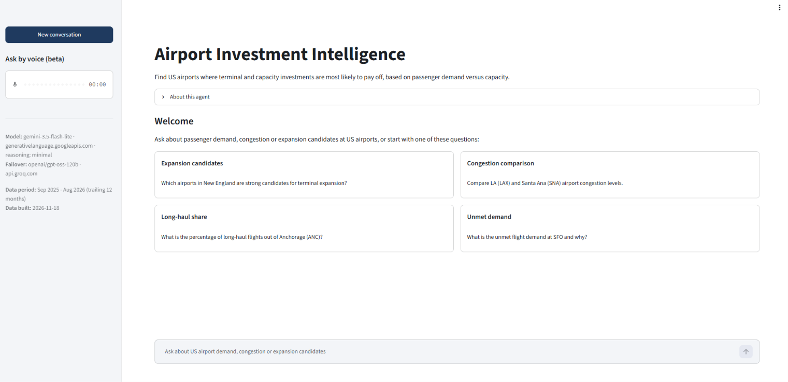
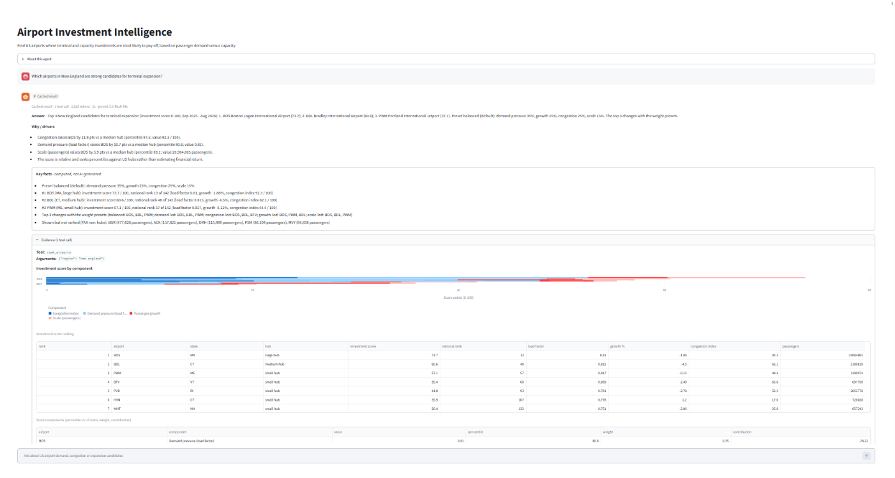
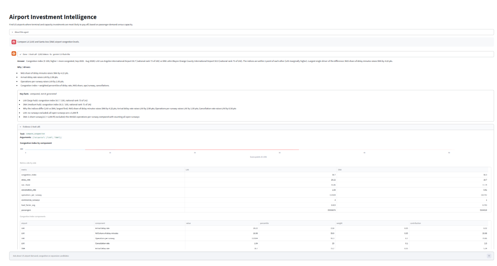

# Airport Investment Intelligence Agent

[](https://github.com/rangoldberg1029/airport-investment-agent/actions/workflows/tests.yml)

A chat agent that helps investment analysts find US airports where terminal and capacity investment is most
likely to pay off, by comparing passenger demand with capacity, using public aviation data and deterministic
scoring.

**Live demo:** _link added at deployment_

| Home | Ranking answer | Evidence |
|---|---|---|
|  |  |  |

## Features

- **Ask in plain language, by text or voice:** expansion candidates by region, congestion comparisons,
  long-haul share, unmet demand and its drivers, airport profiles, live FAA delays.
- **Every number is computed by code.** The LLM chooses tools and writes a short explanation; the Answer line,
  *Key facts* and *Evidence* (tables, charts, sources, assumptions, caveats) come from deterministic Python.
- **Transparent scoring:** percentile-based investment score, congestion index and unmet-demand proxy with
  named weight presets, rank stability and a capacity-gap estimate.
- **Guardrails:** a number-traceability check, a grounding check with an automatic retry, and clear,
  helpful refusals for out-of-scope questions.
- **Fast:** example questions and suggested follow-ups show Key facts in under 0.2 s; explanations stream in.
- **Free to run:** public data and free-tier LLMs (Google Gemini, with optional Groq failover).

## Quickstart

Requires Python 3.12 or newer (tested on 3.12 and 3.14).

```bash
git clone https://github.com/rangoldberg1029/airport-investment-agent.git
cd airport-investment-agent
python -m venv .venv
source .venv/bin/activate          # Windows: .venv\Scripts\activate
pip install -r requirements.txt
cp .env.example .env               # Windows: copy .env.example .env
```

Edit `.env`:

| Variable | | Purpose |
|---|---|---|
| `GEMINI_API_KEY` | required | Language model (free key: https://aistudio.google.com/apikey) |
| `GROQ_API_KEY` | optional | Voice input and automatic failover (free key: https://console.groq.com/keys) |

Then run:

```bash
streamlit run app.py
```

On first start the app builds its local database from the committed data in `data/processed/` (a few
seconds, no network needed). For a deployment, put the same keys in Streamlit secrets
(see `.streamlit/secrets.toml.example`).

## Deploy (Streamlit Community Cloud)

Create an app from this repository with `app.py` as the entry point (the pinned requirements work on the
Python 3.14 runtime the platform uses, and on 3.12). In the app's
**Secrets**, add `GEMINI_API_KEY` (required) and optionally `GROQ_API_KEY`, as in
`.streamlit/secrets.toml.example`. The database builds automatically on first start.

## Running tests

```bash
python -m pytest -q
```

The tests run offline with fake LLMs and need no API keys. GitHub Actions runs them on every push and pull
request.

## Refreshing the data

The app ships with cleaned data for Jan 2024 – Aug 2026. To rebuild it from the sources:

1. Download the BTS T-100 Segment files (one manual download per year; TranStats offers no direct file):
   follow the steps in [`data/raw/README.md`](data/raw/README.md).
2. Run `python -m data.etl --from-raw`. This fetches the other sources, rebuilds `data/airports.duckdb`,
   rewrites `data/processed/` and prints a data-quality report.

`python -m data.etl --offline` rebuilds the database from `data/processed/` only.

## Repository structure

```
app.py                  Streamlit chat UI
agent/                  agent loop, tools, LLM client, prompt, guardrails, computed Answer lines, voice
scoring/                KPIs, indices and rankings (pure functions); all constants in config.py
data/                   ETL, DuckDB access, data-quality checks, one module per source
  processed/            committed cleaned data (parquet) + provenance
  raw/README.md         source URLs, access notes and manual download steps
ui/                     rendering, Key facts, Evidence charts, follow-ups, setup
scripts/                evaluation (eval_agent.py, measure_fast_path.py), CLI and LLM checks
tests/                  offline unit and app tests
docs/eval/              evaluation report and model comparison
docs/data_validation.md source checks and KPI feasibility
DESIGN.md               design, scoring methodology, AI usage, tradeoffs
```

## Design

See [DESIGN.md](DESIGN.md) for the architecture, data sources and validation, scoring methodology, how AI is
used, model evaluation, tradeoffs and limitations.

---

Demo using public data. Not investment advice.
